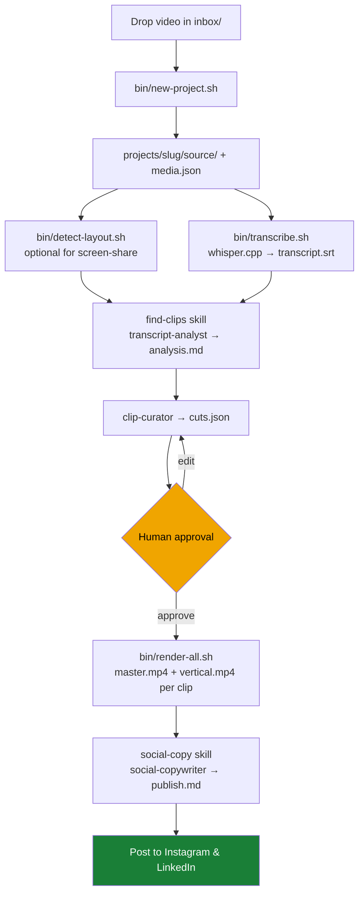
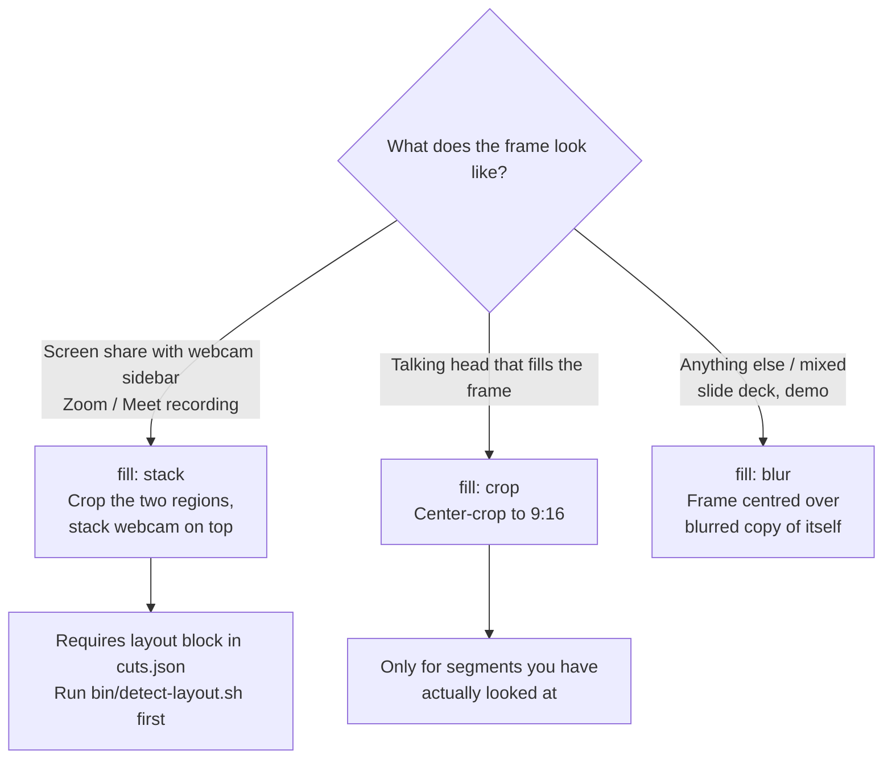
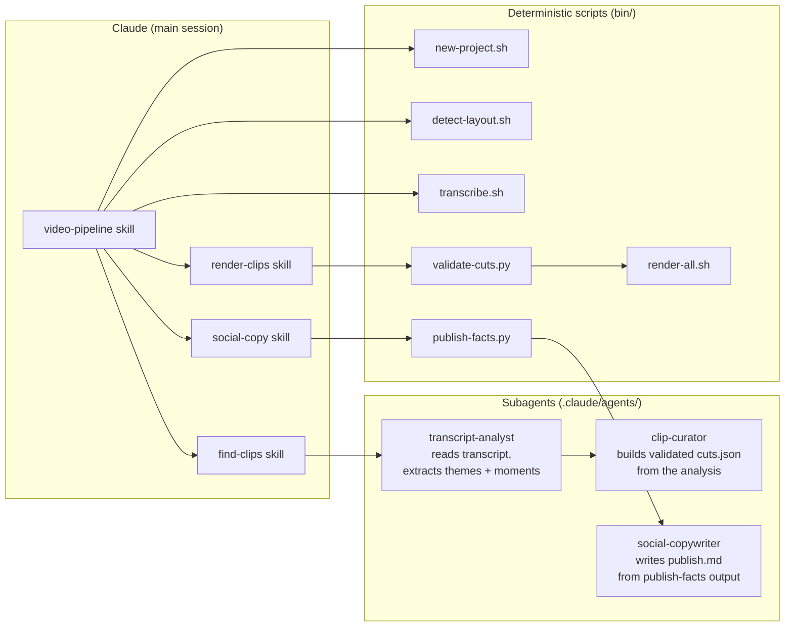

# Agentic Video Editor

Long-form class recordings in → captioned vertical shorts + ready-to-paste social copy out.

```bash
mv "Clase 3.mp4" inbox/
claude "process the video in inbox"
```

Claude ingests the file, transcribes it locally with whisper.cpp, reads the transcript to
find the ideas worth clipping, and proposes a cut plan. You review and approve the plan;
it renders 1080×1920 clips with burned-in captions and clean 16:9 masters, then writes
`publish.md` — per-clip summaries plus ready-to-paste Instagram and LinkedIn copy.

---

## Pipeline overview



**The approval gate at stage 4 is mandatory.** Nothing renders before `cuts.json` is
approved — renders cost minutes of CPU per clip and cut choices are a matter of taste.

---

## Requirements

```bash
brew install ffmpeg whisper-cpp jq
mkdir -p models
curl -L -o models/ggml-medium.bin \
  https://huggingface.co/ggerganov/whisper.cpp/resolve/main/ggml-medium.bin
```

Python 3.9+ (system Python is fine — all scripts use stdlib only, no pip installs).

---

## Quickstart — let Claude drive

Drop the video and run one command. Claude handles everything through the approval gate,
then waits.

```bash
mv "Clase 3.mp4" inbox/
claude "process the video in inbox"
```

Claude will:
1. Create the project (`projects/clase3/`)
2. Detect the screen-share and webcam layout
3. Transcribe with whisper (~real-time on M-series)
4. Analyze the transcript and find the best clips
5. Present a table — id, title, timestamp range, duration, why it works — and **stop**

Review the proposed clips. Edit `cuts.json` directly if you want to adjust start/end
times, drop a clip, or change a title. Then reply:

```
looks good, render them all
```

Claude validates the cuts, renders every clip, and writes `publish.md`.

---

## Manual step-by-step

The Claude skills just drive these scripts. You can run any stage by hand.

### 1. Create a project

```bash
bin/new-project.sh "inbox/Clase 3.mp4"
# → projects/clase3/  with  media.json  (duration, dimensions, fps)
```

The source video is moved into `projects/clase3/source/` — inbox is a staging area, not a
library.

### 1b. Detect screen-share layout (screen recordings only)

```bash
bin/detect-layout.sh clase3
```

Samples across the video and prints the `layout` block to paste into `cuts.json`. Required
before using `fill: "stack"`. Verify the regions before committing:

```bash
ffmpeg -ss 600 -i projects/clase3/source/*.mp4 -vf crop=1440:810:0:135 -frames:v 1 /tmp/screen.png
ffmpeg -ss 600 -i projects/clase3/source/*.mp4 -vf crop=476:268:1444:406 -frames:v 1 /tmp/cam.png
open /tmp/screen.png /tmp/cam.png
```

### 2. Transcribe

```bash
bin/transcribe.sh clase3 es   # ~1× real-time on Apple Silicon
```

Produces `transcript.srt`, `transcript.txt`, and `transcript.json`. The `-ml 42 -sow` flags
produce caption-sized cues split on word boundaries — usable as burned-in subtitles without
further processing.

### 3 + 4. Find and approve clips

Ask Claude (or run the skill directly):

```bash
# via Claude
claude "find clips in clase3"

# skill shortcut
/find-clips
```

This writes `analysis.md` (themes, key ideas, quotable moments with timestamps) and
`cuts.json` (the proposed clip plan). Review the table Claude presents; edit `cuts.json`
if needed.

**cuts.json structure:**

```json
{
  "project": "clase3",
  "source": "source/Clase 3.mp4",
  "language": "es",
  "layout": { "screen": "1440:810:0:135", "camera": "476:268:1444:406" },
  "clips": [
    {
      "id": "01",
      "slug": "titulo-del-clip",
      "title": "El título que se muestra en el short",
      "start": "00:04:20.000",
      "end":   "00:05:58.000",
      "hook":  "La primera frase que engancha.",
      "fill":  "stack",
      "platforms": ["instagram", "linkedin"],
      "hashtags":  ["#IA", "#Programación"]
    }
  ]
}
```

Validate before rendering:

```bash
bin/validate-cuts.py clase3
```

Catches bad timestamps, duplicate ids, clips past the source end, and durations outside
the 8–180 s platform window.

### 5. Render

```bash
bin/render-all.sh clase3            # all clips
bin/render-all.sh clase3 --dry-run  # preview what would render
bin/render-clip.sh clase3 03        # one clip
```

Each clip lands in `projects/clase3/clips/<id>-<slug>/`:

| File | Format | Use for |
|------|--------|---------|
| `vertical.mp4` | 1080×1920, captions burned in | Instagram, TikTok, Shorts |
| `master.mp4` | source aspect ratio, no captions | LinkedIn, YouTube |
| `captions.srt` | rebased + reflowed SRT | editing reference |
| `metadata.json` | cut entry + render facts | downstream tooling |

Both files close on the ADA brand clip (`assets/brand/ada-closing.mp4`): the clip blurs
out and dissolves into the logo animation, adding ≈9 s. It is configured by the `outro`
block in `cuts.json`:

```json
"outro": { "file": "assets/brand/ada-closing.mp4", "transition": "blur", "duration": 1.0 }
```

`transition` is `blur` or any ffmpeg `xfade` name; `duration` is the fade length. Skip it
with `"outro": false` on a clip or `--no-outro` on the command line.

Verify a render visually — a silent ffmpeg exit does not mean captions rendered:

```bash
ffmpeg -ss 5 -i projects/clase3/clips/01-titulo-del-clip/vertical.mp4 \
  -frames:v 1 /tmp/check.png && open /tmp/check.png
```

### 6. Social copy

```bash
/social-copy
# or ask Claude: "write the publish copy for clase3"
```

Writes `publish.md` — a Resumen de la clase, timestamped topics, and for each clip a
Resumen, a Ficha table (file paths, resolution, duration, source range), and pasteable
Instagram and LinkedIn copy. **Stage 6 is not optional**: clips without copy are unfinished
work.

---

## Fill modes

Choosing the wrong fill is the most common mistake. Look at the footage before picking.



| Mode | Best for | What it does |
|------|----------|--------------|
| `stack` | Zoom/Meet screen share with webcam sidebar | Crops the two regions and stacks them — webcam on top, slide at full width below |
| `blur` | Footage that fills the frame (default) | Whole frame centred over a blurred, darkened copy of itself |
| `crop` | Talking-head only, no edges worth keeping | Fills 9:16 by cropping the sides |

`stack` is the right default for these class recordings. `blur` and `crop` are for footage
that fills its frame.

---

## Project layout

```
inbox/                        drop source videos here; new-project.sh moves them
models/ggml-medium.bin        whisper.cpp model (1.4 GB, not in git)
bin/                          pipeline scripts — bash + stdlib Python, no deps
assets/brand/                 ada-closing.mp4 — brand outro appended to every clip
templates/                    cuts.example.json, publish.example.md
projects/<slug>/
  source/<file>.mp4           the original
  media.json                  duration, dimensions, fps
  audio.wav                   16 kHz mono — whisper's input
  transcript.srt|txt|json     full transcript
  analysis.md                 themes, key ideas, quotable moments + timestamps
  cuts.json                   ← the file a human approves
  clips/<id>-<slug>/
    vertical.mp4              1080×1920, burned captions → Instagram / TikTok / Shorts
    master.mp4                source aspect, no captions → YouTube / LinkedIn
    captions.srt              editable transcript for this clip
    captions.ass              styled subtitles burned in
    metadata.json             cut entry + render facts
  publish.md                  summary + Instagram/LinkedIn copy per clip, ready to paste
```

---

## Agent & skill architecture



The subagents (`transcript-analyst`, `clip-curator`, `social-copywriter`) run in their own
context windows so the 50k+ character transcripts don't fill the main session.

---

## Privacy and redaction

Screen shares can expose private URLs, bookmarks, meeting participant panels, and faces.
Check before rendering — this is a consent issue.

```bash
# sample the screen region across a clip
ffmpeg -ss 1200 -i projects/clase3/source/*.mp4 \
  -vf crop=1440:810:0:135 -frames:v 1 /tmp/screen-sample.png
open /tmp/screen-sample.png
```

Cover regions with `redact` in `cuts.json` — per clip or globally under `layout`:

```json
{
  "layout": {
    "screen": "1440:810:0:135",
    "camera": "476:268:1444:406",
    "redact": ["1440:88:0:135"]
  },
  "clips": [
    {
      "id": "07",
      "redact": ["290:445:1150:500"]
    }
  ]
}
```

Boxes are `w:h:x:y` in source pixels. Redaction is applied at the master render stage so
both `master.mp4` and `vertical.mp4` are covered.

---

## Command reference

```bash
bin/new-project.sh "inbox/Clase 3.mp4"   # ingest + probe metadata
bin/detect-layout.sh clase3              # find screen-share / webcam regions
bin/transcribe.sh clase3 es             # whisper.cpp transcription
bin/validate-cuts.py clase3             # ALWAYS run before rendering
bin/render-clip.sh clase3 03            # one clip
bin/render-all.sh clase3               # all clips in cuts.json
bin/render-all.sh clase3 --dry-run     # preview without rendering
bin/publish-facts.py clase3            # text digest of clips + captions
bin/publish-facts.py clase3 --json     # same as JSON
```

**Caption overrides** (environment variables):

| Variable | Default | Effect |
|----------|---------|--------|
| `CAP_FONT` | `Helvetica` | Caption typeface |
| `CAP_SIZE` | `58` | Font size in output pixels |
| `CAP_CHARS` | `30` | Max characters per caption line |
| `CAP_MARGIN` | `420` | Bottom margin in output pixels |

**Outro overrides:**

| Variable | Default | Effect |
|----------|---------|--------|
| `OUTRO_TRANSITION` | `outro.transition` or `blur` | `blur`, or any ffmpeg `xfade` transition |
| `OUTRO_FADE` | `outro.duration` or `1.0` | Transition length in seconds |

**Stack layout overrides:**

| Variable | Default | Effect |
|----------|---------|--------|
| `STACK_CAM_W` | `756` | Webcam panel width in output pixels |
| `STACK_CAM_Y` | `190` | Webcam panel vertical offset |
| `STACK_SCREEN_Y` | `670` | Slide vertical offset |
| `STACK_BG` | `0x0D1117` | Background colour (hex) |

---

## How it's organised

`CLAUDE.md` is the project brief the agents read. `.claude/skills/` holds the stage
playbooks. `.claude/agents/` holds the three subagents that do the reading and writing.
`bin/` contains the deterministic media work — bash and stdlib Python, no external
dependencies, safe to re-run (skips work whose output is already current).

Per-video state lives in `projects/<slug>/`. `cuts.json` is the one file a human
approves; nothing renders before that. `publish.md` is the last thing written and the
first thing you read when it is time to post.
